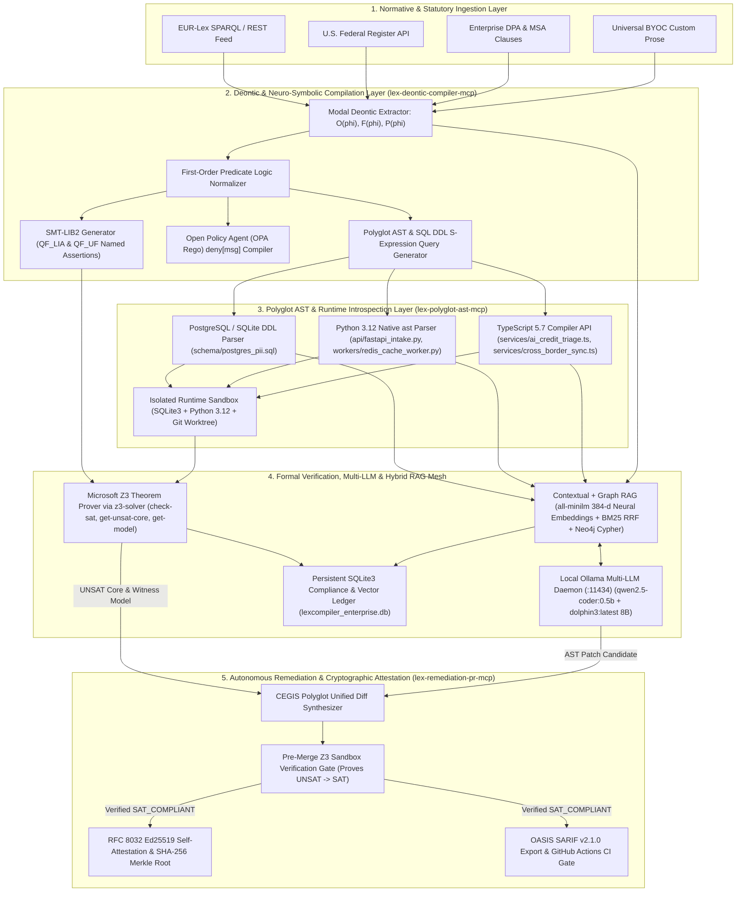

# LexCompiler

**Neuro-Symbolic Law-to-AST Compiler, SMT/Z3 Formal Verifier, and Autonomous Pull Request Enforcer**

`Domain: JusticeSphere AI / ComplianceOS / GovernanceIQ` | `Engine: Microsoft Z3 (z3-solver) + OPA Rego + Polyglot AST` | `Protocol: MCP JSON-RPC 2.0 (2025-03-26)`

---

## Abstract

Enterprise software compliance suffers from a structural impedance mismatch: regulatory statutes and enterprise Data Processing Agreements (DPAs) are authored in natural language, whereas production systems execute as deterministic code and relational schemas. Legal teams interpret regulatory updates in static documents while engineering teams ship hundreds of commits per week across API routes, caching workers, and database schemas.

**LexCompiler** eliminates the manual translation layer between statutory text and source code. It ingests live regulatory feeds (GDPR, HIPAA, EU AI Act, CCPA/CPRA, EUR-Lex, U.S. Federal Register) and custom enterprise contracts, compiles normative clauses into modal deontic logic predicates, synthesizes machine-verifiable **SMT-LIB2** assertions and **Open Policy Agent (OPA / Rego)** rules, and evaluates them against a repository's live **Abstract Syntax Tree (AST)** and **SQL DDL schemas**.

When a statutory clause is amended or a code commit introduces a compliance regression, LexCompiler:
1. Proves the mathematical contradiction (`UNSAT`) using the **Microsoft Z3 Theorem Prover** and extracts the minimal **Unsat Core** and **Counterexample Witness Model**.
2. Pinpoints the exact offending AST nodes and line ranges across SQL, Python, and TypeScript modules.
3. Synthesizes an AST-preserving code patch via Counterexample-Guided Inductive Synthesis (CEGIS), verifies in an isolated Z3 sandbox that the patched AST transitions from `UNSAT` to `SAT`, and commits the remediation branch with an **RFC 8032 Ed25519** cryptographic conformity certificate and **OASIS SARIF v2.1.0** report.

---

## System Architecture



---

## Formal Verification Semantics

Let $R_{\text{Law}}$ denote the conjunction of normative axioms compiled from active statutory clauses, and let $S_{\text{AST}}$ denote the conjunction of concrete program facts extracted from the repository's polyglot AST and SQL DDL schemas.

LexCompiler constructs the verification formula $\Phi = R_{\text{Law}} \land S_{\text{AST}}$ in Quantifier-Free Linear Integer Arithmetic and Uninterpreted Functions (`QF_LIA` / `QF_UF`):

```lisp
(set-logic QF_LIA)
(set-option :produce-models true)
(set-option :produce-unsat-cores true)

(declare-const statutory_max_ttl_hours Int)
(declare-const statutory_requires_tenant_kms Bool)
(declare-const postgres_encrypted_at_rest Bool)
(declare-const postgres_tenant_kms_isolated Bool)
(declare-const postgres_retention_hours Int)
(declare-const fastapi_uses_tenant_kms Bool)
(declare-const redis_worker_ttl_hours Int)

; Statutory Normative Axioms (GDPR Art. 17 & 32 / DPA Section 4.2)
(assert (! (= statutory_max_ttl_hours 72) :named law_max_retention_72h))
(assert (! (= statutory_requires_tenant_kms true) :named law_requires_tenant_kms))

; Universal Compliance Invariants
(assert (! (= postgres_encrypted_at_rest true) :named inv_postgres_encrypted_at_rest))
(assert (! (=> statutory_requires_tenant_kms (= postgres_tenant_kms_isolated true)) :named inv_postgres_tenant_key_isolation))
(assert (! (<= postgres_retention_hours statutory_max_ttl_hours) :named inv_postgres_retention_bound))
(assert (! (=> statutory_requires_tenant_kms (= fastapi_uses_tenant_kms true)) :named inv_fastapi_tenant_kms_envelope))
(assert (! (<= redis_worker_ttl_hours statutory_max_ttl_hours) :named inv_redis_ttl_within_72h))

; Extracted Live Polyglot AST & SQL Schema Facts
(assert (! (= postgres_encrypted_at_rest true) :named ast_postgres_encrypted_true))
(assert (! (= postgres_tenant_kms_isolated false) :named ast_postgres_tenant_kms_false))
(assert (! (= postgres_retention_hours 720) :named ast_postgres_retention_720h))
(assert (! (= fastapi_uses_tenant_kms false) :named ast_fastapi_tenant_kms_false))
(assert (! (= redis_worker_ttl_hours 720) :named ast_redis_ttl_720h))

(check-sat)
```

- If `check-sat` returns `unsat`, the codebase violates the statute. The minimal **Unsat Core** identifies the exact conflicting statutory and AST assertions (e.g., `law_max_retention_72h` vs. `ast_postgres_retention_720h`).
- If `check-sat` returns `sat`, the codebase is mathematically proven compliant (`Q.E.D.`) with respect to the modeled invariants.

---

## Core Subsystems

### 1. Model Context Protocol (MCP) Server Suite (`server/mcp/`)
LexCompiler implements 6 custom MCP servers supporting `stdio` (`server/mcp/stdio-server.ts`), Server-Sent Events (`GET /api/mcp/:serverId/sse`), and Streamable HTTP JSON-RPC 2.0 (`POST /api/mcp/:serverId/rpc`):

| Server ID | Role | Exposed Tools | Transports |
| :--- | :--- | :--- | :--- |
| `lex-statute-ingest-mcp` | EUR-Lex & U.S. Federal Register ingestion and DPA clause normalization | `fetch_live_regulatory_feed`, `parse_dpa_contract_clause` | `stdio`, `sse`, `streamable-http` |
| `lex-deontic-compiler-mcp` | Modal deontic extraction ($O, F, P$), SMT-LIB2, and OPA Rego synthesis | `compile_prose_to_smt_and_rego` | `stdio`, `sse`, `streamable-http` |
| `lex-polyglot-ast-mcp` | Python 3.12 `ast`, TypeScript Compiler API, and SQL DDL introspection | `scan_polyglot_repository_ast` | `stdio`, `sse`, `streamable-http` |
| `lex-z3-prover-mcp` | Microsoft Z3 theorem proving, Unsat Core extraction, and Merkle hashing | `prove_repository_compliance_z3` | `stdio`, `sse`, `streamable-http` |
| `lex-hybrid-rag-mcp` | Anthropic Contextual RAG, 384-d neural vector + BM25 RRF, and Graph RAG | `hybrid_contextual_graph_rag_query` | `stdio`, `sse`, `streamable-http` |
| `lex-remediation-pr-mcp` | CEGIS multi-file unified diff synthesis and Pre-PR Z3 Sandbox gate | `synthesize_and_verify_remediation_pr` | `stdio`, `sse`, `streamable-http` |

### 2. Hybrid Contextual + Graph RAG Engine (`server/rag/hybridRagEngine.ts`)
- **Anthropic-Style Contextual Retrieval**: Prepends structured normative headers (`[Statute, Modality, Jurisdiction, Target AST Scope]`) to every chunk prior to indexing.
- **Variable Proposition & Late AST Chunking**: Splits statutes along deontic propositions and source code along AST function/table boundaries.
- **Dense Neural Embeddings + BM25 Hybrid RRF**: Computes 384-dimensional dense embeddings via Ollama `all-minilm:latest` (`POST /api/embeddings`) fused with Okapi BM25 sparse keyword scores and 2-hop Knowledge Graph traversal boosts.
- **HyDE & Corrective RAG (CRAG)**: Expands natural-language compliance queries into hypothetical SMT-LIB2 assertions before retrieval and evaluates faithfulness via RAGAS metrics.

### 3. Five-Stage Token Optimization Waterfall (`server/optimization/tokenOptimizer.ts`)
1. **Codeburn**: Strips comments, import boilerplate, and non-PII helper branches from Python, TypeScript, and SQL ASTs.
2. **Graphify**: Serializes multi-file source code and SQL schemas into compact S-expression Compliance Property Graphs.
3. **LLMLingua-2 / Caveman**: Removes non-normative statutory recital stopwords while preserving 100% of deontic operators (`must`, `shall not`), numeric bounds (`72 hours`, `85%`), and article citations.
4. **Semantic Chunk Deduplication**: Eliminates overlapping retention and encryption clauses across frameworks using cosine similarity thresholds.
5. **KV-Cache Prefix Pinning & Local Model Routing**: Pins static SMT-LIB2/Rego ontologies in KV-cache prefixes and routes high-frequency AST triage to local Ollama models.

### 4. Real-World Local Sandbox & Enterprise Suite (`server/sandbox/` & `server/enterprise/`)
- **Live Runtime Sandbox (`server/sandbox/realWorldSandbox.ts`)**: Executes `target-repo/schema/postgres_pii.sql` in SQLite3, runs `target-repo/api/fastapi_intake.py` and `target-repo/workers/redis_cache_worker.py` in Python 3.12, captures live stdout logs and Redis `SETEX` TTL parameters, and manages Git commits in an isolated repository worktree.
- **RFC 8032 Ed25519 Self-Attestations (`server/enterprise/enterpriseSuite.ts`)**: Signs canonical Z3 Merkle proof payloads using Node's native `crypto.sign(null, payload, ed25519PrivateKey)` with live tamper detection via `crypto.verify`.
- **OASIS SARIF v2.1.0 & GitHub Actions Gate (`.github/workflows/lexcompiler-gate.yml`)**: Exports static analysis results compatible with GitHub Advanced Security Code Scanning.

---

## Getting Started

### Prerequisites
- **Node.js** >= 22.0.0
- **Python** >= 3.10 (used for native Python `ast` parsing and runtime sandbox execution)
- **Ollama** (optional but recommended for local `qwen2.5-coder:0.5b`, `dolphin3:latest`, and `all-minilm:latest` 384-d neural embeddings on `http://localhost:11434`)

### Installation & Verification

```bash
# 1. Install dependencies
npm install

# 2. Run the automated Vitest verification suite (Z3 Prover, Polyglot AST, MCP, RAG, Token Optimizer)
npm test

# 3. Execute the 6-stage real-world local sandbox verification in the terminal
npm run verify:realworld

# 4. Build the production bundle and start the server on http://localhost:3001
npm run build
npm start
```

### The Web App

`http://localhost:3001` is the product: sign in, then Overview, Rules (the rule card Legal approves), Checks, Exceptions, Evidence (signed log and share links), Coding assistants (personal MCP tokens) and Settings. The original engine screens are at `/lab`.

```bash
# Demo workspace "FinHealth AI" with four sign-in accounts (passwords go to data/demo-accounts.txt)
npm run seed:demo -- --demo
# Email and password sign-in
LEXCOMPILER_SIGN_IN=password npm run start:tsx
```

Coding assistants connect to `POST /mcp` with a token from the Coding assistants page. `docs/HANDOFF.md` has the full demo script; `docs/PRODUCT_GUIDE.md` section 5.9 has the configuration for each client.

### Developer Scripts

| Script | Purpose |
| :--- | :--- |
| `npm run dev` | API server (`tsx watch`) and Vite UI together |
| `npm start` | Compiled server from `dist-server/` (run `npm run build` first) |
| `npm run start:tsx` | Server straight from TypeScript sources |
| `npm test` | Vitest suite: server tests in Node, and UI tests in jsdom (dashboard, IDE drawer, agent console, keyboard and ARIA behaviour, WCAG AA colour contrast) rendered from a real scan. Runs on scratch copies; `target-repo/` is never modified |
| `npm run typecheck` | `tsc --noEmit` for the UI and the server |
| `npm run lint` | ESLint flat config (`eslint.config.js`) |
| `npm run verify:cli` | Compliance gate (exit 0 passed, 1 failed, 2 internal error) |
| `npm run verify:realworld` | End-to-end sandbox demo |
| `npm run setup:sandbox` | Creates `.venv` with the real FastAPI, Pydantic, httpx and Redis packages for the runtime sandbox |
| `npm run sarif` | Writes `lexcompiler.sarif` (SARIF v2.1.0) for the scanned repository |

### Scanning Your Own Repository

```bash
LEXCOMPILER_TARGET_REPO=/path/to/repo npm run verify:cli
```

With `LEXCOMPILER_TARGET_REPO` set, the gate proves every clause against that repository and exits `1` if any clause is `UNSAT_VIOLATION` or `UNKNOWN_NEEDS_REVIEW`. The repository is only read. Without it, the gate runs on a scratch copy of the bundled non-compliant fixture and checks that every violation is detected and remediated.

### Open Policy Agent

Each compiled clause carries a Rego v1 policy. When an `opa` binary is on `PATH` (or `LEXCOMPILER_OPA_BIN` points to one), the scan evaluates those policies with `opa eval`, and `policyDenialSource` reads `opa`. CI installs OPA 1.4.2, and the Docker image ships it.

### Tree-sitter Structural Queries

`astPatternQuery` holds real Tree-sitter queries for the Python and TypeScript grammars (WASM, from `@vscode/tree-sitter-wasm`) and the SQL grammar (`server/analyzer/grammars/tree-sitter-sql.wasm`, rebuilt with `npm run build:sql-grammar`, which needs clang and wasm-ld). The scan report returns their matches per clause in `structuralQueryMatches`.

### GitHub App: Checking Pull Requests

LexCompiler runs as a GitHub App. On every pull request it adds a check run named `LexCompiler / compliance`, with an annotation on each line that breaks an approved rule.

- **It never runs your code.** It downloads the commit's archive, reads the `.py`, `.ts` and `.sql` files in memory, parses them, and proves them against the rules with Z3. Symlinks, `node_modules` and hidden folders are skipped.
- **A pull request fails only for findings it adds.** Findings that already exist on the default branch show as warnings, so turning LexCompiler on doesn't turn every pull request red. A rule Z3 can't decide gives `action_required`, never a pass.
- **Default-branch pushes are scanned as the baseline.** That check is `neutral` and never blocks.
- Scans use the rule versions Legal approved, and record the commit, the rule-version hashes and the LexCompiler build.
- Webhooks are verified with `X-Hub-Signature-256`, and redeliveries are ignored. Scans run in a job queue kept in the database, so queued work survives a restart.

**Set it up from the browser.** No manual app settings are needed.

1. GitHub must reach the webhook. Testing locally, open a relay channel at [smee.io/new](https://smee.io/new) and run:
   ```bash
   npx smee-client --url https://smee.io/<channel> --target http://127.0.0.1:3001/api/github/webhooks
   ```
   Smee parses and re-stringifies each body, which changes GitHub's escaping of `<`, `>` and `&`. Set `LEXCOMPILER_GITHUB_WEBHOOK_RELAY=smee` and LexCompiler restores that escaping before checking the signature. The HMAC still has to match, so nothing GitHub didn't sign gets through. A tunnel that forwards the raw bytes, such as `cloudflared tunnel --url http://localhost:3001`, needs no setting.
2. Start LexCompiler with `LEXCOMPILER_GITHUB_WEBHOOK_URL=https://smee.io/<channel>`, `LEXCOMPILER_GITHUB_WEBHOOK_RELAY=smee` and `LEXCOMPILER_PUBLIC_URL=http://localhost:3001`.
3. As an administrator, open `http://localhost:3001/github/register` and click **Create the GitHub App on GitHub**.
   - GitHub creates a private app from a manifest. It requests Checks: write, Pull requests: write, Contents: read and Metadata: read, and subscribes to pull request, push, check run and check suite events.
   - The app id, private key, webhook secret and OAuth client credentials come back once and are saved to `data/github-app.json` with mode 0600.
   - Add `?org=<name>` to the URL to create the app in an organization.
4. As a workspace owner, open `http://localhost:3001/github/install`, pick the repositories and install. Before linking, LexCompiler asks GitHub to confirm that your GitHub account can access the installation, because the `installation_id` on the setup URL can be forged. A first scan of each default branch is then queued.
5. Optionally, make the check required: **Settings → Rules → Rulesets**, then "Require status checks to pass" with `LexCompiler / compliance`. On the Free plan this works for public repositories.

In production, set the credentials with environment variables instead (see the configuration reference). `GET /api/github/app` reports whether an app is configured; it returns no secrets.

### Opening Remediation Pull Requests on GitHub

```bash
LEXCOMPILER_GITHUB_TOKEN=ghp_… LEXCOMPILER_GITHUB_REPO=owner/name npm start
curl -X POST -H 'X-LexCompiler-Client: cli' http://127.0.0.1:3001/api/remediation/open-github-pr
```

Only a `READY_TO_MERGE` remediation (post-patch Z3 `SAT`) can be opened. Optional: `LEXCOMPILER_GITHUB_BASE` (base branch; defaults to the repository's default branch), `LEXCOMPILER_GITHUB_PATH_PREFIX` (where the scanned files live inside the GitHub repository), and `GITHUB_API_URL` (GitHub Enterprise).

### Sign-in and Workspaces (OIDC)

Set `LEXCOMPILER_OIDC_ISSUER` and `LEXCOMPILER_OIDC_CLIENT_ID` (plus `LEXCOMPILER_OIDC_CLIENT_SECRET` for confidential clients and `LEXCOMPILER_OIDC_REDIRECT_URI`, e.g. `https://lexcompiler.example.com/api/auth/callback`) to require sign-in with your identity provider. Users whose roles claim (`LEXCOMPILER_OIDC_ROLES_CLAIM`, default `roles`) contains `LEXCOMPILER_OIDC_ADMIN_ROLE` (default `lexcompiler-admin`) are administrators. Everyone else gets `LEXCOMPILER_DEFAULT_PROJECT_ROLE` (default `viewer`) on the single-repository demo endpoints, and their membership role inside workspaces.

Workspaces (`/api/workspaces`) hold one company's members, repositories, counterparties, rules and scans in the database at `data/lexcompiler.db` (SQLite, migrated on start). Sessions are stored there too, so sign-ins survive a restart; only a SHA-256 of each session id is kept. Roles:

| Action | owner | legal | engineer | viewer |
| :--- | :-: | :-: | :-: | :-: |
| Connect repositories, invite members | ✓ | | | |
| Draft, approve, reject and retire rules; decide exceptions | | ✓ | | |
| Request exceptions, run scans | ✓ | ✓ | ✓ | |
| Create counterparties and share links | ✓ | ✓ | | |
| View everything in the workspace | ✓ | ✓ | ✓ | ✓ |

A rule is enforced only after Legal approves a version of it. Each version freezes the compiled clause, and scans record the rule versions, their hashes and the LexCompiler build they ran with. People are invited by email and join at their first sign-in. Local repositories must live inside `LEXCOMPILER_PROJECT_REPOS_ROOT` (default `repos/`). `npm run seed:demo -- --activate-builtins` creates the demo workspace "FinHealth AI" with the four built-in clauses approved as R-1 to R-4.

### LLM Agents and Framework Adapters

Set `LEXCOMPILER_LLM_MODEL` (plus `LEXCOMPILER_LLM_PROVIDER` = `openai` | `anthropic`, `LEXCOMPILER_LLM_BASE_URL`, `LEXCOMPILER_LLM_API_KEY`), or per agent `LEXCOMPILER_AGENT_<ID>_MODEL` (e.g. `LEXCOMPILER_AGENT_Z3_FORMAL_CRITIC_MODEL=deepseek-reasoner` with `LEXCOMPILER_AGENT_Z3_FORMAL_CRITIC_BASE_URL=https://api.deepseek.com/v1`). Configured agents reason over their MCP tools with real tool calls and return validated structured output; the others call their tool directly.

The Python adapters in `agents/` run each agent in its named framework (CrewAI, DSPy, Hermes, LangGraph, Pydantic-AI, OpenAI Agents SDK) against a running server. Their models go through the server's agent route (`/api/agents/llm/v1`, operator token only), which uses the agent's `LEXCOMPILER_AGENT_<ID>_*` model, holds the key, and caps the agents at `LEXCOMPILER_AGENT_MAX_DAILY_TOKENS` cloud tokens a day:

```bash
python3 -m venv .venv-agents && .venv-agents/bin/pip install -r agents/requirements.txt
cd agents && ../.venv-agents/bin/python -m lexcompiler_agents agent-z3-formal-critic
```

`npm run eval:rag` scores retrieval on the labelled dataset (`server/rag/eval/dataset.json`); with `LEXCOMPILER_AGENT_RAG_JUDGE_MODEL` set it also runs the RAGAS-style judge.

### External MCP Servers

Copy `mcp-servers.example.json` to `mcp-servers.json` (or point `LEXCOMPILER_EXTERNAL_MCP_CONFIG` at another file) to connect external MCP servers over stdio or streamable HTTP. `/api/mcp/servers` shows each one as `ONLINE` with its live tools once it answers `initialize`, and `POST /api/mcp/external/:id/call` calls its tools.

The DuckDB server runs in memory; it reads the SQLite ledger with `ATTACH 'data/lexcompiler_enterprise.db' AS ledger (TYPE sqlite, READ_ONLY)`. `uvx` servers download their packages on first start, which can exceed the 20 s `initialize` timeout, so run each once (for example `uvx mcp-neo4j-cypher --help`) before the first probe. On Windows, `npx` and other `.cmd` commands are started through `cmd.exe` with every argument escaped.

### Scanning Repositories in GitHub Actions

```yaml
jobs:
  compliance:
    uses: shahriar-ahmed-seam/LexCompiler/.github/workflows/lexcompiler-scan.yml@main
    with:
      clauses-file: compliance/clauses.json   # [{ "rawLegalText": "...", "citation": "GDPR Art. 6" }]
    permissions:
      contents: read
      security-events: write
```

The workflow uploads the findings to GitHub code scanning and fails the job when a clause is not proven compliant. Locally, the same clauses file works with `LEXCOMPILER_CLAUSES_FILE=… LEXCOMPILER_TARGET_REPO=… npm run verify:cli`.

### Configuration Reference

| Variable | Default | Purpose |
| :--- | :--- | :--- |
| `PORT` | `3001` | HTTP port |
| `LEXCOMPILER_TARGET_REPO` | bundled `target-repo/` | Repository to scan |
| `LEXCOMPILER_TARGET_REPO_IS_FIXTURE` | unset | `1` treats the target as the demo fixture |
| `LEXCOMPILER_MAX_SCANNED_FILES` | `2000` | Source files read from the target repository; `verify:cli` fails the gate when a scan stops at this limit |
| `LEXCOMPILER_SANDBOX_GIT_DIR` | `data/sandbox-git` | Git directory for remediation commits |
| `LEXCOMPILER_DATA_DIR` | `data/` | Ledger, vector store, persisted clauses, signing key |
| `LEXCOMPILER_SIGNING_KEY_PEM` / `LEXCOMPILER_SIGNING_KEY_PATH` | generated in the data dir | Ed25519 attestation key |
| `LEXCOMPILER_POSTGRES_URL` | unset (in-process PostgreSQL via PGlite) | PostgreSQL server for the sandbox schema run |
| `LEXCOMPILER_REDIS_URL` | unset (fakeredis) | Redis server for the sandbox cache worker |
| `LEXCOMPILER_SANDBOX_PYTHON` | `.venv` Python | Interpreter for the runtime sandbox |
| `LEXCOMPILER_PGVECTOR_URL` | unset (PGlite in `data/pgvector`) | PostgreSQL + pgvector server for RAG chunk vectors |
| `LEXCOMPILER_NEO4J_URL`, `LEXCOMPILER_NEO4J_USER`, `LEXCOMPILER_NEO4J_PASSWORD`, `LEXCOMPILER_NEO4J_DATABASE` | unset (in-memory graph) | Neo4j for the Graph RAG traversal (Cypher) |
| `LEXCOMPILER_RERANKER_MODEL`, `LEXCOMPILER_RERANKER_LOCAL_DIR`, `LEXCOMPILER_RERANKER_DTYPE` | unset | BGE cross-encoder reranker through transformers.js (`npm install @huggingface/transformers`) |
| `LEXCOMPILER_SIGNER` | `local` | Attestation signer: `local` (Ed25519 key file), `gcp-kms` (`LEXCOMPILER_GCP_KMS_KEY_VERSION`, Cloud HSM supported), or `aws-kms` (`LEXCOMPILER_AWS_KMS_KEY_ID`) |
| `LEXCOMPILER_TSA_URL` | unset | RFC 3161 Time-Stamp Authority used to timestamp attestation signatures |
| `LEXCOMPILER_SANDBOX_CONTAINER`, `LEXCOMPILER_SANDBOX_IMAGE`, `LEXCOMPILER_SANDBOX_OCI_RUNTIME` | unset | Run the runtime sandbox in a locked-down container (`docker`/`podman`, image from `Dockerfile.sandbox`, optional `runsc` for gVisor) |
| `LEXCOMPILER_OPA_BIN` | `opa` on `PATH` | OPA binary |
| `LEXCOMPILER_PYTHON` | first of `python3`, `python`, `py -3` that is Python >= 3.10 | Python interpreter for AST parsing and the runtime sandbox |
| `OLLAMA_HOST` | `http://localhost:11434` | Ollama endpoint |
| `OPENAI_API_KEY` | unset | Server-side key for cloud mode, so the browser never sends one |
| `LEXCOMPILER_INPUT_PRICE_PER_MTOK_USD` | built-in | Input price for token-cost estimates |
| `LEXCOMPILER_CACHE_READ_MULTIPLIER` | built-in | Price multiplier for cached input tokens |
| `LEXCOMPILER_PREFILL_TOKENS_PER_SEC` | built-in | Prefill throughput for latency estimates |
| `LEXCOMPILER_PUBLIC_URL` | `http://localhost:<PORT>` | Address people use to reach LexCompiler; used in links from GitHub check runs and as the GitHub App's callback URLs |
| `LEXCOMPILER_GITHUB_WEBHOOK_URL` | `<public URL>/api/github/webhooks` | Webhook URL put in the GitHub App manifest (a relay such as smee.io when testing locally) |
| `LEXCOMPILER_GITHUB_APP_ID`, `LEXCOMPILER_GITHUB_APP_PRIVATE_KEY_PATH` (or `LEXCOMPILER_GITHUB_APP_PRIVATE_KEY`), `LEXCOMPILER_GITHUB_WEBHOOK_SECRET`, `LEXCOMPILER_GITHUB_APP_SLUG`, `LEXCOMPILER_GITHUB_CLIENT_ID`, `LEXCOMPILER_GITHUB_CLIENT_SECRET` | unset | GitHub App credentials from the environment; otherwise `data/github-app.json` written by `/github/register` |
| `LEXCOMPILER_GITHUB_WEBHOOK_RELAY` | unset | `smee` when deliveries come through smee.io, which re-stringifies JSON (signatures are still checked) |
| `LEXCOMPILER_GITHUB_APP_FILE` | `data/github-app.json` | Where the manifest flow saves the app's credentials |
| `GITHUB_API_URL`, `LEXCOMPILER_GITHUB_WEB_URL` | `https://api.github.com`, `https://github.com` | GitHub endpoints (GitHub Enterprise Server) |
| `LEXCOMPILER_GITHUB_TOKEN`, `LEXCOMPILER_GITHUB_REPO`, `LEXCOMPILER_GITHUB_BASE`, `LEXCOMPILER_GITHUB_PATH_PREFIX` | unset | GitHub pull-request integration |

The security settings (`HOST`, `LEXCOMPILER_API_TOKEN`, `LEXCOMPILER_ALLOWED_ORIGINS`, `LEXCOMPILER_ALLOWED_HOSTS`, `LEXCOMPILER_ENABLE_RUNTIME_SANDBOX`) are described in [Security Model](#security-model).

### Invoking the Stdio MCP Server Directly

```bash
echo '{"jsonrpc":"2.0","id":1,"method":"initialize"}' | npx tsx server/mcp/stdio-server.ts lex-z3-prover-mcp
```

### Docker Deployment

```bash
LEXCOMPILER_API_TOKEN="$(openssl rand -hex 32)" docker compose up --build -d
```

The container listens on `0.0.0.0`, so it requires `LEXCOMPILER_API_TOKEN`. The web UI asks for the token once per browser session.

### Security Model

The API can rewrite `target-repo/` files and create Git commits, so the server is locked down by default:

| Setting | Default | Effect |
| :--- | :--- | :--- |
| `HOST` | `127.0.0.1` | Bind address. The server refuses to start on a non-loopback host without `LEXCOMPILER_API_TOKEN`. |
| `LEXCOMPILER_API_TOKEN` | unset | When set, every `/api` route except `/api/health` requires `Authorization: Bearer <token>`. |
| `LEXCOMPILER_ALLOWED_ORIGINS` | `http://localhost:5173`, `http://127.0.0.1:5173`, `http://localhost:3001`, `http://127.0.0.1:3001` | Browser origins allowed by CORS and by the request guard. |
| `LEXCOMPILER_ALLOWED_HOSTS` | unset | Extra `Host` names accepted without a token (the default accepts loopback only, to block DNS rebinding). |
| `LEXCOMPILER_ENABLE_RUNTIME_SANDBOX` | `0` | Set to `1` to enable `GET /api/sandbox/verify-runtime`, which executes the target-repo Python in a local process. It runs on a temp copy with resource limits, but that is **not** an isolation boundary; enable it only on a trusted machine. |

Without a token, API clients must send the `X-LexCompiler-Client` header (the bundled UI does this automatically):

```bash
curl -H 'X-LexCompiler-Client: cli' http://127.0.0.1:3001/api/state
```

`POST /api/repo/update-file` only accepts the tracked `target-repo/` files. `POST /api/remediation/apply-pr` and `apply-node` return `409` when the post-patch Z3 check still reports violations.

Built-in clauses and curated feed items are **illustrative**: they paraphrase the cited regulations and add scenario parameters (such as a 72-hour purge window or an 85% confidence gate) that are not in the official texts. They are tagged `ILLUSTRATIVE` in the UI and `illustrative: true` in the API.

---

## REST & MCP API Reference

| Method | Endpoint | Description |
| :--- | :--- | :--- |
| `GET` | `/api/health` | Service health check across Z3, AST parsers, and MCP servers |
| `GET` | `/api/state` | Full compliance scan report, Z3 proofs, AST graph, and PR #409 |
| `POST` | `/api/clauses/compile` | Compiles custom statutory/contractual prose into Z3 SMT-LIB2 & Rego |
| `POST` | `/api/clauses/mutate-preset` | Triggers a regulatory amendment scenario and recalculates blast radius |
| `POST` | `/api/remediation/apply-pr` | Applies synthesized AST patches to `target-repo/` and re-verifies `SAT` |
| `POST` | `/api/remediation/open-github-pr` | Pushes the `READY_TO_MERGE` remediation to a branch and opens a GitHub pull request |
| `GET` | `/api/sandbox/verify-runtime` | Executes `target-repo/` on PostgreSQL, FastAPI / Pydantic / Redis (Python), and TypeScript |
| `GET` | `/api/services/mesh` | Live telemetry from Ollama (`:11434`), Z3, and SQLite vector ledger |
| `POST` | `/api/llm/multi-model-pipeline` | Runs `all-minilm` 384-d embeddings + `qwen2.5-coder` + `dolphin3` |
| `POST` | `/api/mcp/:serverId/rpc` | MCP JSON-RPC 2.0 `tools/call` endpoint for all 6 custom MCP servers |
| `POST` | `/api/rag/query` | Executes Hybrid Contextual + Graph RAG query with RAGAS scoring |
| `POST` | `/api/enterprise/byoc-scan` | Universal BYOC scanner for custom contracts and source code |
| `GET` | `/api/enterprise/certificate` | Generates an RFC 8032 Ed25519 signed self-attestation (persistent key, published at `/api/enterprise/public-key`; not a legal conformity certificate) |
| `POST` | `/api/enterprise/verify-signature` | Verifies an attestation against the server's trusted public key |
| `POST` | `/api/enterprise/revoke` | Revokes an attestation certificate or signing key (administrators) |
| `GET` | `/api/enterprise/revocations` | Published revocation list |
| `GET` | `/api/enterprise/sarif` | Exports OASIS SARIF v2.1.0 static analysis report |

---

## License

MIT License (see [`LICENSE`](LICENSE)). Built by Shahriar Ahmed Seam for the International AI Builders Congress (JusticeSphere AI — ComplianceOS / GovernanceIQ Track).
